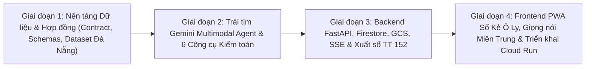

# ROADMAP.md: Lộ trình Xây dựng Sản phẩm Hoàn chỉnh 100% — Dự án Keiki

Tài liệu này thay thế hoàn toàn giới hạn 30% trước đây để hướng tới mục tiêu **xây dựng sản phẩm Keiki hoàn chỉnh 100% (Production-Ready)** phục vụ trình diễn và chấm điểm tại **GDG DevFest Miền Trung 2026**.

---

## Tổng quan 4 Giai đoạn Phát triển (Milestones)

---

## Giai đoạn 1: Khởi tạo Kiến trúc, Hợp đồng Dữ liệu & Bộ dữ liệu Đà Nẵng

Mục tiêu: Thiết lập toàn bộ cấu trúc repo, kiểu dữ liệu thống nhất giữa `agent/`, `backend/`, `frontend/` và bộ dữ liệu thực tế của hộ kinh doanh tại Đà Nẵng.

- [ ] **M1-01 (AI-01 & AI-02):** Tạo `agent/schemas.py` (Pydantic v2 khớp 100% `docs/CONTRACT.md`), khảo sát cấu trúc cột sổ **Thông tư 152/2025/TT-BTC** (`agent/data/tt152_columns.json` cho mẫu `S1-HKD`, `S2-HKD`, `S3-HKD`).
- [ ] **M1-02 (AI-01):** Tạo bộ dữ liệu chuẩn Đà Nẵng gồm `agent/data/tax_codes_demo.json` (30 mã số thuế mẫu đầu `040...`), `agent/data/price_history_demo.json` (lịch sử giá nhập các mặt hàng thiết yếu), `agent/data/central_dialect_dict.json` (từ điển phương ngữ miền Trung & khẩu ngữ chợ truyền thống), và bộ mẫu `agent/eval/dataset/labels.jsonl`.
- [ ] **M1-03 (BE-01):** Khởi tạo `backend/app/main.py`, `config.py`, `errors.py`, `models.py`, `.env.example`, `requirements.txt` và endpoint `GET /api/health`.
- [ ] **M1-04 (FE-01):** Khởi tạo dự án React 18 + Vite + TypeScript (`strict`) + Tailwind CSS + Google Fonts `Be Vietnam Pro` + Material Symbols trong `frontend/`, tạo `src/types/contract.ts` và `src/i18n/vi.ts`.

---

## Giai đoạn 2: Xây dựng Trái tim AI Agent với Google Gemini API (`agent/`)

Mục tiêu: Hoàn thiện toàn bộ năng lực đọc hiểu đa phương thức (Ảnh hóa đơn, Ảnh chuyển khoản VietQR, Giọng nói phương ngữ miền Trung), đối chiếu trùng chéo và chủ động hỏi lại.

- [ ] **M2-01 (AI-03 & AI-04):** Viết trọn bộ prompt chuyên biệt trong `agent/prompts/`:
  - `extract_receipt.vi.md` (bóc tách hóa đơn giấy, sổ viết tay, màn hình chuyển khoản & phân loại nhóm ngành thuế TT 152).
  - `extract_voice.vi.md` (nghe hiểu phương ngữ miền Trung: Đà Nẵng, Quảng Nam, Huế).
  - `report_summary.vi.md` (nhận xét tình hình kinh doanh & đánh giá hồ sơ tín dụng vay vốn ngân hàng).
- [ ] **M2-02 (AI-05):** Xây dựng `agent/normalize.py` chuẩn hóa số tiền tiếng Việt & khẩu ngữ (*"bảy trăm rưỡi ngàn", "hai củ", "sáu xị"* → số nguyên VND), ngày tháng, tên đối tác/mặt hàng và ánh xạ từ điển phương ngữ miền Trung. Kèm bộ unit test `pytest` (>= 25 ca kiểm thử).
- [ ] **M2-03 (AI-06):** Xây dựng `agent/extract.py` và `agent/voice.py` gọi trực tiếp **Google Gemini API (`google-genai` SDK, `gemini-2.5-flash`)** với `response_schema=ExtractionResult`, hỗ trợ cache theo `sha256` và retry an toàn.
- [ ] **M2-04 (AI-07):** Xây dựng trọn bộ 6 công cụ kiểm toán trong `agent/tools/`:
  1. `validate_totals.py`: Kiểm tra tổng thành tiền từng dòng so với tổng thanh toán (`TOTAL_MISMATCH`).
  2. `duplicates.py`: Phát hiện trùng cùng loại (`DUPLICATE`) và **trùng chéo giữa Hóa đơn giấy ↔ Ảnh chuyển khoản ↔ Giọng nói (`CROSS_DUPLICATE`)** trong khung ±1 ngày.
  3. `price.py`: Phát hiện biến động đơn giá nhập bất thường > 30% so với trung vị lịch sử (`PRICE_ANOMALY`).
  4. `taxcode.py`: Tra cứu tính hợp lệ của mã số thuế nhà cung cấp (`TAX_CODE_NOT_FOUND`).
  5. `category.py`: Phân loại `category` và `tax_group` (1,5% / 3% / 4,5% / 7%) theo Thông tư 152/2025/TT-BTC.
  6. Kiểm tra thiếu trường hoặc độ tin cậy thấp (`MISSING_FIELD`, `LOW_CONFIDENCE`).
- [ ] **M2-05 (AI-08):** Xây dựng `agent/decide.py`, `agent/events.py`, `agent/report.py` và điểm vào `agent/api.py` (`process_document`), tự động sinh câu hỏi chủ động `clarification_question` bằng tiếng Việt tự nhiên khi cần xác nhận.
- [ ] **M2-06 (AI-09):** Xây dựng công cụ đo kiểm tự động `agent/eval/run_eval.py` và `metrics.py`, xuất báo cáo thực nghiệm `docs/EVAL_RESULTS.md`.

---

## Giai đoạn 3: Xây dựng Backend, Cơ sở dữ liệu Google Cloud & Xuất sổ TT 152 (`backend/`)

Mục tiêu: Hoàn thiện toàn bộ dịch vụ Backend kết nối **Google Cloud Firestore**, **Google Cloud Storage**, điều phối tiến trình AI qua **SSE** và xuất sổ đúng chuẩn quy định.

- [ ] **M3-01 (BE-02):** Hiện thực `repositories/base.py`, `repositories/memory.py` (nạp sẵn dữ liệu mẫu hộ kinh doanh Đà Nẵng phong phú) và `repositories/firestore.py` (**Google Cloud Firestore**).
- [ ] **M3-02 (BE-03):** Hiện thực `routers/documents.py` (tải lên ảnh hóa đơn, ảnh chuyển khoản, file ghi âm; lưu **Google Cloud Storage** hoặc ổ cứng local khi chạy thử; tự động kích hoạt `JobRunner`) và `routers/jobs.py` (trạng thái Job + luồng SSE thời gian thực `GET /api/jobs/{id}/stream`).
- [ ] **M3-03 (BE-04):** Hiện thực `routers/transactions.py` đầy đủ: danh sách có bộ lọc, nhập tay, sửa (`PATCH`), xóa (`DELETE`), duyệt (`POST /api/transactions/{id}/confirm` kèm tính năng **Gộp chứng từ trùng chéo `merge_into_duplicate=true`**), và từ chối (`reject`).
- [ ] **M3-04 (BE-05):** Hiện thực `services/report.py` và `routers/report.py`: tính toán doanh thu, chi phí, lợi nhuận, bảng thuế ước tính theo nhóm ngành Thông tư 152/2025/TT-BTC (`tax_breakdown`), chỉ số minh bạch hồ sơ vay vốn ngân hàng (`loan_readiness`), mặt hàng tăng giá và nhận xét từ Gemini (`summary_text`).
- [ ] **M3-05 (BE-06):** Hiện thực `services/exporter.py` và `routers/export.py`: xuất file Excel `.xlsx` chuẩn **Thông tư 152/2025/TT-BTC** (gồm các sheet `S1-HKD` Sổ doanh thu, `S2-HKD` Sổ vật liệu/hàng hóa, `S3-HKD` Sổ chi phí, và `HoSoVayVon` Tóm tắt dòng tiền minh bạch), tương thích mở trực tiếp trên **Google Sheets**, kèm tùy chọn xuất gói `.zip` chứa toàn bộ ảnh chứng từ gốc và bảng đối chiếu CSV.
- [ ] **M3-06 (BE-07):** Hiện thực `routers/demo.py` (`POST /api/demo/reset` để khôi phục nhanh kịch bản demo Đà Nẵng) và tùy chọn `GET /api/tts` (gọi Google Cloud Text-to-Speech / fallback Web Speech API).

---

## Giai đoạn 4: Xây dựng Frontend PWA Hoàn chỉnh & Triển khai Google Cloud Run (`frontend/` & Deploy)

Mục tiêu: Mang lại giao diện "Cuốn sổ kẻ ô ly" cực kỳ thân thiện với tiểu thương lớn tuổi, hoạt động mượt trên cả điện thoại và máy tính.

- [ ] **M4-01 (FE-02 & FE-03):** Hoàn thiện hệ thống design tokens sổ kẻ ô ly (`tokens.css`), chế độ **"Chữ to cho cô chú"**, API client, SSE hook (`useJobStream`), Recorder hook (`useRecorder`), Clipboard Paste hook (`useClipboardImage`) và tiện ích đọc giọng nói tiếng Việt (`utils/speech.ts`).
- [ ] **M4-02 (FE-04):** Hoàn thiện màn **Thêm chứng từ (`AddPage`)** với 3 phương thức hoạt động 100%:
  1. **Chụp ảnh hóa đơn** (nén ảnh thông minh trên trình duyệt trước khi gửi).
  2. **Dán ảnh chuyển khoản** (hỗ trợ bấm nút dán trực tiếp từ Clipboard hoặc `Ctrl+V` / chọn ảnh màn hình VietQR).
  3. **Nói một câu để ghi** (ghi âm giọng nói phương ngữ miền Trung kèm gợi ý câu mẫu trực quan).
  - Tích hợp **Khung tiến trình AI Keiki (`AgentTimeline`)** hiển thị trực tiếp từng bước suy luận của Gemini qua SSE.
- [ ] **M4-03 (FE-05):** Hoàn thiện màn **Sổ kế toán (`LedgerPage`)**: hiển thị dòng kẻ ô ly với lề đỏ, đóng **con dấu xanh "ĐÃ GHI SỔ"** (`Stamp`), hiển thị huy hiệu **"Đủ 2 chứng từ (Hóa đơn + CK)"** cho các giao dịch đã gộp, xem chi tiết ảnh gốc/nghe lại câu ghi âm, lọc theo loại/tháng và nhập tay.
- [ ] **M4-04 (FE-06):** Hoàn thiện màn **Cần hỏi lại (`ReviewPage`)**: nổi bật câu hỏi chủ động của Keiki (`clarification_question`) kèm nút **🔊 Nghe Keiki hỏi**, tô màu dạ quang các trường nghi ngờ, hiển thị thẻ so sánh và nút **"Gộp vào hóa đơn gốc (Tránh cộng trùng tiền)"** khi phát hiện `CROSS_DUPLICATE`.
- [ ] **M4-05 (FE-07):** Hoàn thiện màn **Báo cáo & Xuất sổ (`ReportPage`)**: biểu đồ thu chi, bảng ước tính thuế theo nhóm ngành Thông tư 152/2025/TT-BTC, thẻ **Hồ sơ Tín dụng Minh bạch (Vay vốn Ngân hàng)**, nhận xét của AI và khu vực tải sổ Excel `.xlsx` / gói chứng từ `.zip` / hướng dẫn mở trên **Google Sheets**.
- [ ] **M4-06 (FE-08 & BE-08):** Cấu hình PWA hoàn chỉnh với **Google Workbox**, đóng gói `Dockerfile` multi-stage, kiểm thử tích hợp toàn luồng và triển khai lên **Google Cloud Run** (`asia-southeast1`).
